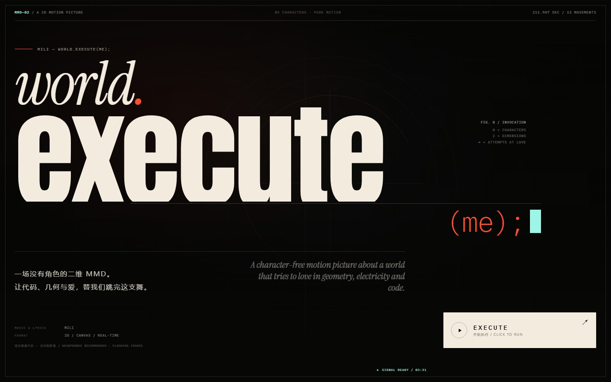
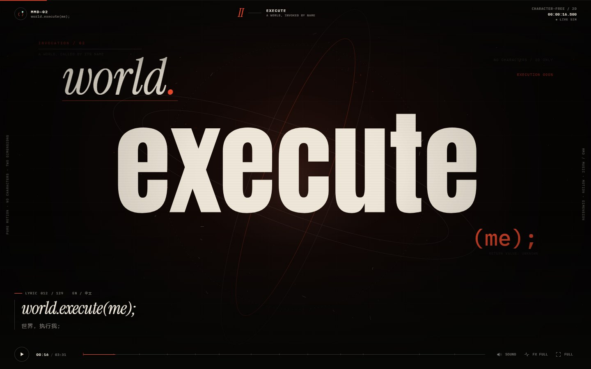
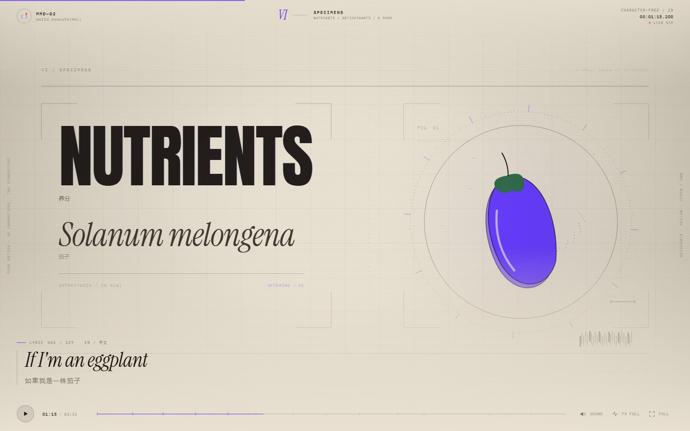
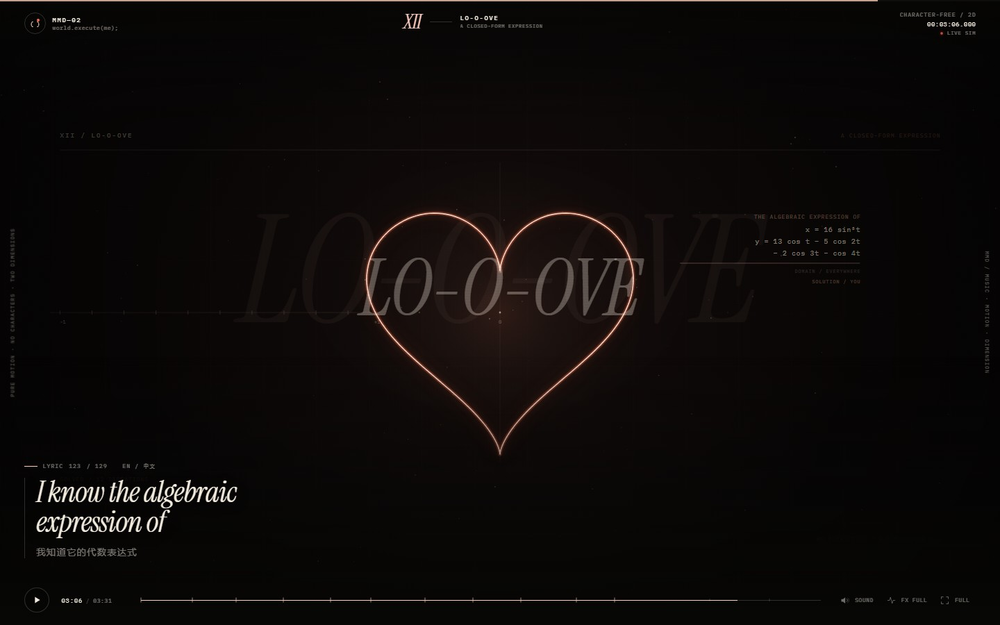
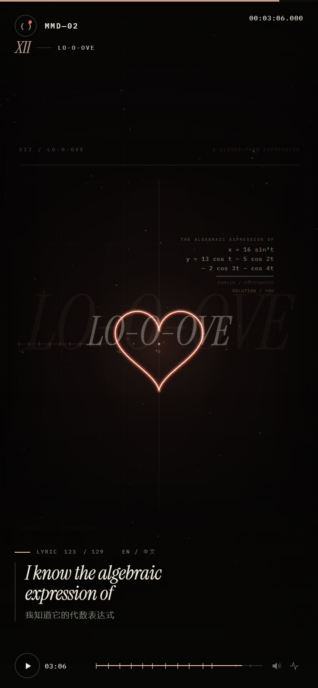
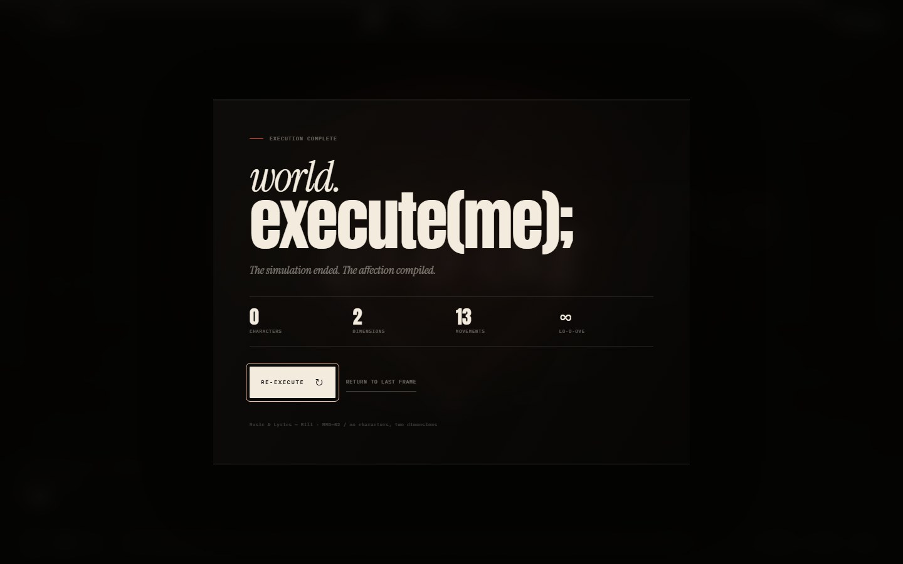

# world.execute(me); — MMD—02

A character-free 2D motion picture for **Mili — world.execute(me);**, built as a
single-page TypeScript experience.

No models. No illustrated people. No characters. Only typography, geometry,
electricity, ash and a simulated heart, moving in sync with the song and its
129 subtitle cues.

**Live site:** https://hxac.github.io/world-execute-me-mmd/



## Watch it

```bash
npm install
npm run dev
```

Open the printed local URL, click **EXECUTE**, and allow the audio to play.

For a production check:

```bash
npm run build
npm run preview:static
# choose another port:
# Windows PowerShell: $env:PORT = "4317"; npm run preview:static
# macOS / Linux:      PORT=4317 npm run preview:static
```

The static preview server (`scripts/serve-dist.mjs`) has Range support for the
audio file, so seeking works in Chrome, Edge and Firefox.

## Selected frames

| | |
| --- | --- |
|  |  |
|  |  |

<p align="center">
  
</p>



## What is inside

- **13 movements**, from `GENESIS` to `AFTERIMAGE`, each with its own palette,
  geometry, type treatment and camera energy.
- **Real-time canvas 2D rendering** — no video file, no character model, no
  animation library. The frame is drawn every display tick from the playhead.
- **Web Audio analysis** drives the pulse, particles and shards.
- **Bilingual subtitles** generated from the supplied SRT (English + 中文).
- A light "field guide" interlude for the eggplant / tomato / purr / god verse,
  drawn as objects rather than characters.
- A parametric heart for the final `LO-O-OVE` section, annotated with its
  actual equations.
- Start, pause, seek, mute, fullscreen, and a soft-motion / reduced-flash mode.

### Keyboard

| Key | Action |
| --- | --- |
| `Space` | start / play / pause |
| `←` / `→` | seek 5 seconds |
| `M` | mute |
| `F` | fullscreen |
| `Esc` | leave the end card (or fullscreen) |

## Project map

```
index.html                 shell, HUD, start card, end card
src/main.ts                transport, captions, theme transitions, controls
src/audio.ts               audio element + Web Audio analyser envelope
src/stage.ts               the 13 canvas movements and typography system
src/gfx.ts                 math, tracked type, heart curve and helpers
src/data.ts                acts, timings, helpers
src/lyrics.ts              generated lyric/subtitle cue data
src/style.css              editorial HUD, responsive layout, start/end cards
public/media/              browser-friendly audio (MP3)
scripts/serve-dist.mjs     dependency-free static preview server
```

## Generation / 生成说明

This project was generated by **deepseek v4.1 flash 1017**.

一句话提示词：

> 根据歌曲和歌词，设计网页（typescript）纯动效无角色 2D 的 MMD

## License

The original website source code and generated visual design are released under
the [MIT License](LICENSE).

**Third-party content is not covered by the MIT license.** The music, recording,
and lyrics of `world.execute(me);` belong to **Mili** and their respective rights
holders. They are included as source material for this unofficial, non-commercial
fan project and may not be redistributed under this project's license. The three
typefaces are distributed under the SIL Open Font License; their license texts
are in [`public/licenses/`](public/licenses/). See
[`THIRD_PARTY_NOTICES.md`](THIRD_PARTY_NOTICES.md) for details.

## Notes

The page deliberately starts only after a user gesture, both for audio autoplay
rules and because the opening shot deserves a click.

Built with TypeScript, Canvas 2D, Web Audio, Vite and three open typefaces
(Anton, Instrument Serif, IBM Plex Mono).
