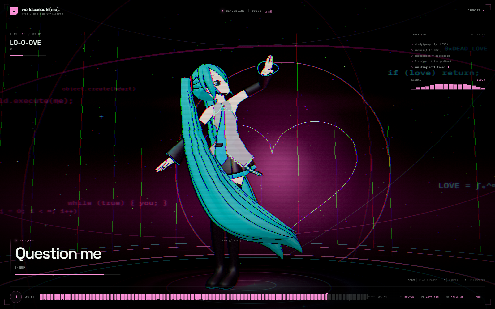
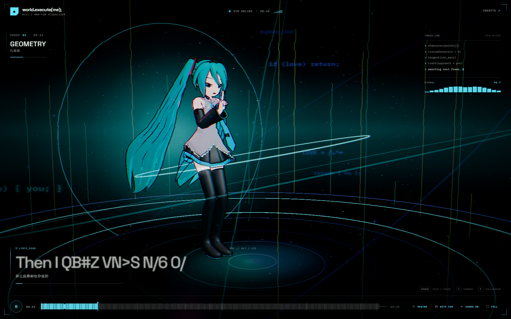
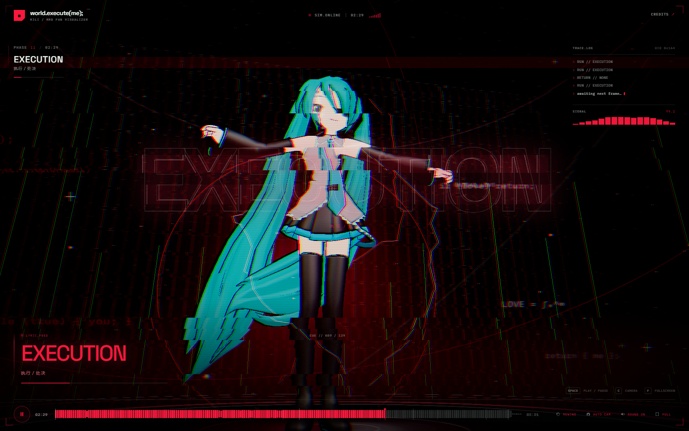

# world.execute(me); — MMD Web Visualizer

A real-time, typescript-built MMD music video for **Mili — world.execute(me);**.

The page turns the song's machine-love lyrics into an interactive terminal stage: Hatsune Miku dances in a WebGL simulation, SRT lyrics arrive as a live data feed, uppercase words detonate into giant typographic stamps, and the stage re-codes itself for every phase of the song. Nothing is pre-rendered.



## Run it

Requirements: Node.js 20+, a current Chrome/Edge/Firefox, WebGL2 and audio.

```bash
npm install
npm run dev
```

Open **http://127.0.0.1:4173/**.

```bash
npm run build     # tsc --noEmit + production bundle in dist/
npm run preview   # preview the production build
```

All runtime assets are local. No external CDN, API, tracker, or network connection is required.

## How to watch

1. Click **EXECUTE SIMULATION** to unlock audio and begin the 3:32 song.
2. Drag or click the waveform to seek.
3. Put on headphones. The low-frequency energy drives the stage in real time.

| Control | Action |
| --- | --- |
| `Space` | Play / pause |
| `←` / `→` | Seek 5 seconds |
| `C` | Toggle auto-direction camera / free orbit camera |
| `M` | Mute / unmute |
| `F` | Fullscreen |
| `Esc` | Close credits |

Credits and full asset/licence notes live behind **CREDITS** in the top-right corner.

Deep link: after starting, `?t=83` jumps to 01:23. Example: `http://127.0.0.1:4173/?t=148`. You can also drive the scenes from the browser console through `window.__WORLD_EXECUTE_ME__` (`seek`, `pause`, `play`, `setCamera`).

## The direction

The song is already a program, so the page is designed as its runtime.

- **Three visual layers**: a real MMD character and dance, a wireframe simulation lattice, and a terminal/interpreter interface. They share one clock.
- **Lyrics are the script**: 129 SRT cues drive the lyric dock, 49 uppercase cues trigger full-screen stamps, and the current cue chooses geometry, camera language and stage colour.
- **The stage is coded**:
  - boots in monochrome green, then titles the song with a `world.execute(me);` call;
  - materialises point clouds, a circumference, a sine wave, an infinity curve and a heart curve exactly while they are named in the lyrics;
  - turns AC/DC into electric arcs, stimulation into pink strobe, isolation into an empty blue stage;
  - treats the repeated `EXECUTION` count as a hard-cut sequence of red frames;
  - ends with `exit_code = LOVE;` and a recursive replay prompt.
- **MMD theatre, not a music player**: toon model, outline pass, shadowing, MMD physics (Ammo.js), IK-solved dance and a hand-animated camera that cuts with the lyrics.
- **Real-time audio analysis**: a Web Audio analyser bends light intensity, bloom, beat pulses and the camera shake; the seek-bar waveform is generated from the supplied master.

### Phase map

| Phase | Approx. time | Visual language |
| --- | --- | --- |
| 00 `BOOT_SEQUENCE` | 00:00–00:16 | Dormant stage, green scan, boot log |
| 01 `WORLD.EXECUTE_ME` | 00:16–00:29 | Title call, first camera cut |
| 02 `GEOMETRY` | 00:29–00:44 | Points, circumference, sine, infinity |
| 03 `ALTERNATING_CURRENT` | 00:44–00:59 | AC/DC arcs, yellow/cyan |
| 04 `STIMULATION` | 00:59–01:14 | Pink stage, rising energy |
| 05 `ORGANIC_VARIABLES` | 01:14–01:28 | Warm organic palette |
| 06 `ROLE_SWITCH` | 01:28–01:43 | Elevated camera, violet |
| 07 `VIBRATION` | 01:43–01:50 | Close, resonant beats |
| 08 `ISOLATION` | 01:50–01:58 | Wide, cold, sparse |
| 09 `FRAGMENTS` | 01:58–02:05 | Glitching fragments |
| 10 `ILLEGAL_ARGUMENTS` | 02:05–02:27 | Error red, grid wall |
| 11 `EXECUTION` | 02:27–02:42 | Hard-cut red execution sequence |
| 12 `ONLY_EXECUTION` | 02:42–02:53 | Pink-red close shots |
| 13 `LO-O-OVE` | 02:53–03:15 | Heart curve, dual rim colours |
| 14 `TRAPPED_IN_LOVE` | 03:15–03:25 | Empty blue, floating |
| 15 `FINAL_EXECUTION` | 03:25–03:32 | Final red glitch, exit card |

### Stills

| GEOMETRY | EXECUTION |
| --- | --- |
|  |  |

## Code map

```text
index.html                 semantic UI shell, intro, credits, ending
src/main.ts                playback state machine, cue scheduling, keyboard/deep links
src/audio.ts               <audio> + Web Audio analyser, transient/beat detection
src/data.ts                lyric types, 16 phase definitions, camera directions, palette
src/stage.ts               Three.js scene, MMD loading, MMD physics/IK, props, camera direction
src/postfx.ts              outline → bloom → custom grade/glitch/scanline pipeline
src/ui.ts                  waveform, timeline, lyric feed, stamps, HUD, modal, ending
src/style.css              responsive editorial/terminal visual system
scripts/prepare-data.mjs   regenerates lyrics.json, waveform.json, motion.json, AAC preview
public/mmd/                Miku PMD + wavefile_v2 VMD + embedded asset readmes
public/audio/              local AAC render of the supplied song
public/data/               generated cue, waveform and motion metadata
public/fonts/              self-hosted Space Grotesk and IBM Plex Mono
```

### MMD pipeline

`MMDLoader.loadWithAnimation()` loads `miku_v2.pmd` and `wavefile_v2.vmd`, and `MMDAnimationHelper` drives the dance with CCD IK and Ammo.js rigid-body physics for hair and skirt. A fixed-step physics fallback and a lower-cost path are available if Ammo is unavailable.

The file dimensions are measured after load, the model is normalised to 3.18 world units, and the camera uses a framing-rule that keeps the silhouette in view across 16 distinct shot designs. The path is piped through a custom outline/bloom/composite stack; the MMD mesh is the only outlined object, the stage is excluded from the outline hull.

## Credits and licenses

**This is a local, fan-made, non-commercial project. It is not affiliated with Mili, Crypton Future Media, or MMD.**

- **Song / lyrics** — *Mili — world.execute(me);*. Song and lyric rights remain with Mili and their respective rights holders. The audio and SRT were supplied for this local project; they are not covered by the software licences below.
- **MMD model** — Hatsune Miku sample model bundled with MMD, distributed in the three.js r160 examples. Hatsune Miku is © Crypton Future Media, INC. Usage should follow the [Piapro character guidelines](https://piapro.net/en_for_creators.html) and the original model readme. See `public/mmd/readme_miku_v2.txt`, `public/mmd/LICENSE`, and `public/mmd/Readme.txt`.
- **Dance data** — `wavefile_v2.vmd` from the three.js r160 examples; the original example credits the dance data to [sm13147122](https://www.nicovideo.jp/watch/sm13147122) and the model data to [evpvp](https://sites.google.com/view/evpvp/).
- **Engine / libraries** — [three.js](https://threejs.org/) r160 (MIT), MMDLoader/MMDAnimationHelper and Ammo.js as distributed with three.js. The MMD assets themselves are **not** MIT-licensed.
- **Type** — Space Grotesk (SIL Open Font License), IBM Plex Mono (SIL OFL). Self-hosted subsets in `public/fonts/`.
- **Licence texts** — included under `public/licenses/`.
- **Visuals / code** — original TypeScript, GLSL and direction for this project.

Do not publish or redistribute the bundled MMD model, motion data, or song commercially. If this page is to be made public, obtain the appropriate permissions and replace any local-only assets accordingly.

## Rebuilding data

The derived JSON files and AAC preview are committed so the page can run offline. To rebuild them from the supplied `.flac` and `.srt` (requires ffmpeg):

```bash
npm run prepare:data
```

The script also re-encodes the audio preview and recreates the local waveform.
